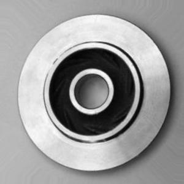
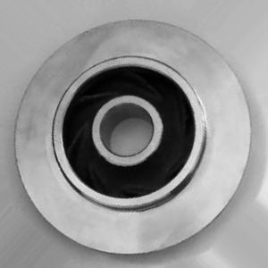
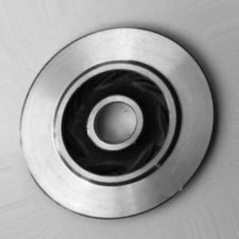
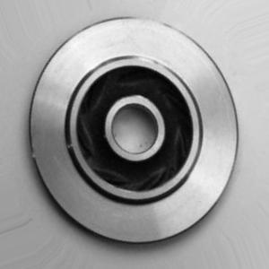
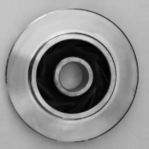
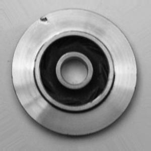
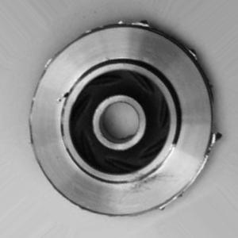
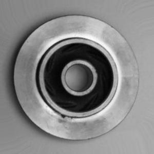
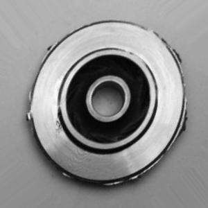
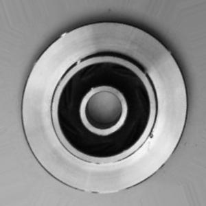

| image | true | predicted | confidence | p(defect) | total ms |
|---|---|---|---|---|---|
|  | normal | normal (OK) | 1.0 | 0.0 | 33.39 |
|  | normal | normal (OK) | 1.0 | 0.0 | 17.26 |
|  | normal | normal (OK) | 1.0 | 0.0 | 17.48 |
|  | normal | normal (OK) | 1.0 | 0.0 | 17.5 |
|  | normal | normal (OK) | 1.0 | 0.0 | 17.68 |
|  | defective | defective (OK) | 0.999 | 1.0 | 16.67 |
|  | defective | defective (OK) | 1.0 | 1.0 | 16.83 |
|  | defective | defective (OK) | 0.9699 | 1.0 | 17.15 |
|  | defective | defective (OK) | 0.9997 | 1.0 | 17.12 |
|  | defective | defective (OK) | 0.9992 | 1.0 | 17.84 |